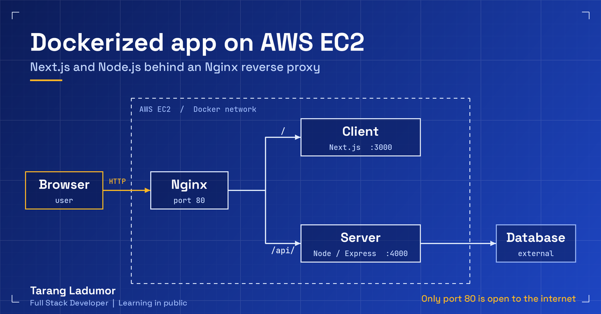

# Week 1: Docker + EC2 + Nginx

Goal: run a full stack app on a real server, in containers, behind a reverse proxy, with only one public port.

**Status:** ✅ done and working



## What I built

- A **Next.js** frontend and a **Node/Express** backend, each with its own Dockerfile
- One **Docker Compose** file that builds and runs both, plus an **Nginx** container in front
- An **EC2** instance (Ubuntu 24.04) with Docker installed
- Nginx routes `/` to the frontend and `/api/` to the backend, so only port 80 is public
- The database is external, so there is no database container

The app's own repos are private. This folder holds the DevOps files only, with names and secrets removed.

## Request flow

```
Browser --> Nginx :80 --+--> /      --> frontend (Next.js :3000)
                        +--> /api/  --> backend  (Express :4000) --> database
```

Frontend and backend have no published ports. They are reachable only inside the Docker network.

## Folder layout on the server

The compose file sits next to the two app repos, because it belongs to neither:

```
app/
├── frontend/            # Next.js repo (has its own Dockerfile)
├── backend/             # Node/Express repo (has its own Dockerfile)
├── docker-compose.yml
├── nginx/default.conf
└── .env                 # not committed
```

## Files in this folder

| File | Purpose |
|---|---|
| `docker-compose.yml` | Builds and runs frontend, backend and Nginx |
| `Dockerfile.frontend` | Multi-stage Next.js build (reference copy) |
| `Dockerfile.backend` | Node/Express image (reference copy) |
| `nginx/default.conf` | Reverse proxy rules |
| `.env.example` | Variables for Compose (build args) |
| `server.env.example` | Variable names for the backend container |

The Dockerfiles are simplified reference copies. In the real project each one lives in its own app repo.

## AWS setup

1. Billing budget with an email alert, MFA on root, and an IAM user for daily work
2. EC2: Ubuntu 24.04, 20 GB gp3 disk (the default was too small), key pair for SSH
3. Security group:

| Port | Source | Why |
|---|---|---|
| 22 (SSH) | My IP only | Admin access |
| 80 (HTTP) | My IP while testing | Nginx |

Ports 3000 and 4000 are not open.

## Commands I ran

```bash
# connect
ssh -i my-key.pem ubuntu@<EC2-PUBLIC-IP>

# install
sudo apt update && sudo apt upgrade -y
sudo apt install -y docker.io docker-compose-v2 git
sudo usermod -aG docker ubuntu

# swap for the Next.js build on a small instance
sudo fallocate -l 2G /swapfile && sudo chmod 600 /swapfile
sudo mkswap /swapfile && sudo swapon /swapfile

# clone both repos next to each other
mkdir app && cd app
git clone <frontend-repo-url> frontend
git clone <backend-repo-url> backend

# validate and run
docker compose --env-file ./frontend/.env config
docker compose --env-file ./frontend/.env up -d --build
docker compose ps
docker compose logs --tail=50 backend
```

## Environment variables

- `NEXT_PUBLIC_API_URL` is baked in at **build time**. Changing it needs a rebuild.
- Use the public address without a port, for example `http://<EC2-PUBLIC-IP>/api/v1`, because the browser calls it through Nginx.
- Real `.env` files are never committed. See `.env.example` and `server.env.example` for names only.

## What broke

Full details are in [../mistakes.md](../mistakes.md).

1. Build killed by out-of-memory, fixed with swap
2. `ENOSPC`, fixed by resizing the EBS volume
3. Timeout, fixed in the security group
4. Empty `NEXT_PUBLIC_API_URL`, fixed with a build arg and a rebuild
5. YAML indentation error, found with `docker compose config`

## What I'd do differently

- Build the images in CI and pull them on the server, so EC2 never builds (that's Week 2)
- Use HTTPS with a domain, because cookies and OAuth callbacks need it
- Use an Elastic IP or a domain, because the public IP changes when the instance is stopped
- Use a read-only deploy key instead of a personal access token

## Next

Week 2: GitHub Actions to build images, push to ECR, and deploy to ECS.
