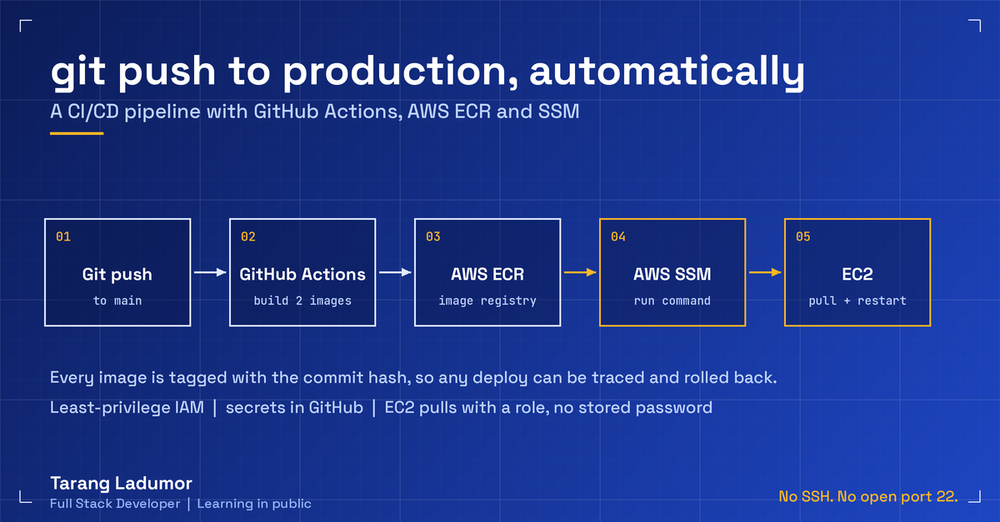

# Week 2: CI/CD with GitHub Actions, ECR and SSM

Goal: a `git push` to `main` builds the app, stores the images in AWS, and updates the running server, with no manual steps.

**Status:** ✅ done and working

## What I built

A MERN app (React frontend, Express and MongoDB backend) that I built myself. Its code lives in its own repo. This folder holds the pipeline files, with account details and secrets removed.

1. **Push to `main`** triggers GitHub Actions.
2. **Job `build-and-push`** builds two Docker images (frontend and backend) and pushes them to **AWS ECR**. Each image gets two tags: the commit hash, which makes every deploy traceable and easy to roll back, and `latest`.
3. **Job `deploy`** sends a command to the EC2 server through **AWS Systems Manager (SSM)**. The server logs in to ECR, pulls the new images and restarts the containers.

No SSH, and no inbound port 22 is needed for deploys.

## Why these choices

| Choice | Reason |
|---|---|
| ECR instead of Docker Hub | Private by default, and the EC2 role pulls images with no stored password |
| Two ECR tags (commit hash + `latest`) | Traceable deploys and easy rollback |
| SSM instead of SSH from the workflow | No SSH key in GitHub, and no open port 22 |
| Least-privilege IAM | The CI user can only push to two repositories and run commands on one instance |
| Relative API URL (`/api/v1`) in the frontend build | The same image works on any server, because Nginx forwards `/api/` to the backend |
| Nginx re-resolves the backend name | Recreating the backend container does not cause 502 errors |

## Files

| File | Purpose |
|---|---|
| `workflow/ecr.yml` | The GitHub Actions workflow (lives in `.github/workflows/` of the app repo) |
| `deploy/docker-compose.yml` | Compose file on the server, using ECR images |
| `deploy/.env.example`, `deploy/server.env.example` | Variable names only |
| `nginx/default.conf` | Reverse proxy rules inside the frontend image |
| `iam/github-ecr-push.json` | Permission to push to two ECR repositories |
| `iam/github-ssm-deploy.json` | Permission to run commands on one instance |

## Setup order

1. Create two ECR repositories (`studynotion-server`, `studynotion-client`) in the same region as the server.
2. Create the IAM policies in `iam/` (fill in the placeholders), a user `github-actions` with both attached, and an access key.
3. In GitHub: secrets `AWS_ACCESS_KEY_ID` and `AWS_SECRET_ACCESS_KEY`, and variables `AWS_REGION` and `EC2_INSTANCE_ID`.
4. EC2: attach a role with `AmazonEC2ContainerRegistryReadOnly` and `AmazonSSMManagedInstanceCore`, and install the AWS CLI (`sudo snap install aws-cli --classic`).
5. On the server: create the deploy folder with `docker-compose.yml`, `.env` and `server.env`, then run it once by hand to check it works.
6. Push to `main` and watch the **Actions** tab.

## What broke

Details are in [../mistakes.md](../mistakes.md).

## What I'd do differently

- Use GitHub OIDC instead of long-lived access keys
- Add automated tests before the build step
- Use a domain and HTTPS, plus an Elastic IP, so the allowed origin never changes
- Move to ECS or Kubernetes (next weeks) instead of Compose on one server
